# Supplier Performance & Material Quality Analytics

An end-to-end analytics solution combining **Data Warehousing (DW)**, **OLAP / Business Intelligence** and **Data Mining (Apriori association rules)** to evaluate supplier performance and material quality for an electric-motorcycle manufacturer.

> MSc Big Data Analytics, Victoria University Kampala

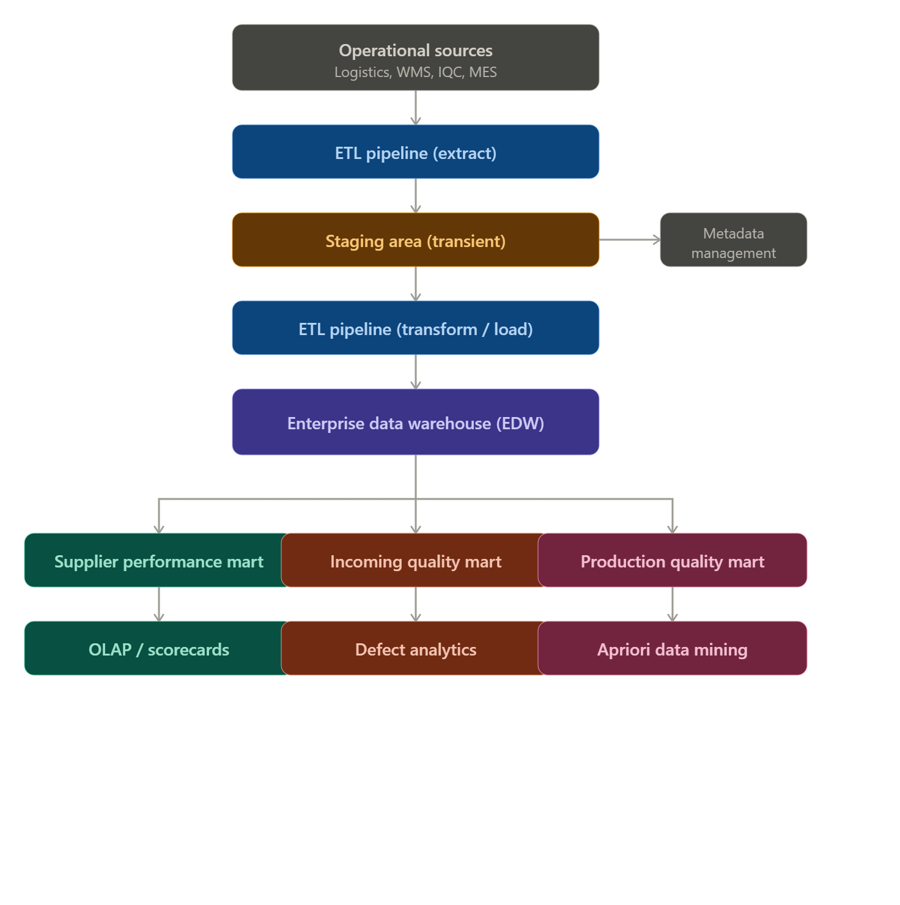

## Table of Contents
- [Business Problem](#business-problem)
- [Objectives](#objectives)
- [Data Ecosystem](#data-ecosystem)
- [Data Warehouse Design](#data-warehouse-design)
- [Multidimensional Model (Galaxy Schema)](#multidimensional-model-galaxy-schema)
- [Data Preparation](#data-preparation)
- [Data Mining with Apriori](#data-mining-with-apriori)
- [Evaluation and Validation](#evaluation-and-validation)
- [Business Intelligence Dashboards](#business-intelligence-dashboards)
- [Future-State Architecture](#future-state-architecture)
- [Tech Stack](#tech-stack)
- [Getting Started](#getting-started)
- [Limitations](#limitations)
- [References](#references)

## Business Problem

Spiro is an African electric-mobility company that deploys electric motorcycles and battery-swapping infrastructure. Its production depends on a global supply chain (lithium-ion batteries, motors, brakes, tyres, controllers), so supplier quality directly affects vehicle safety, reliability and brand reputation.

At Spiro Uganda, procurement, inventory, quality-inspection and production data sit in **disconnected silos**. Management cannot get a unified view of supplier performance, spot recurring defects tied to specific vendors, or manage supply-chain risk proactively. Decisions on vendor selection and contract renewal stay reactive.

## Objectives

**General objective:** design and develop a centralized analytics solution, using data warehousing and data mining, to evaluate supplier performance and material quality.

**Specific objectives**
- **Data integration (ETL):** extract, transform and load fragmented supplier data into one warehouse
- **Warehouse design:** build a multidimensional model for historical supplier analysis
- **OLAP reporting:** enable slice-and-dice, drill-down and trend analysis
- **Data mining:** apply the Apriori algorithm to find hidden supplier / material / quality patterns
- **Risk identification:** isolate supplier-material combinations linked to high rejection rates
- **Decision support:** deliver actionable intelligence for procurement and quality teams
- **Framework evaluation:** assess the impact on operational performance and supply-chain resilience

## Data Ecosystem

Data is generated along a sequential component lifecycle:

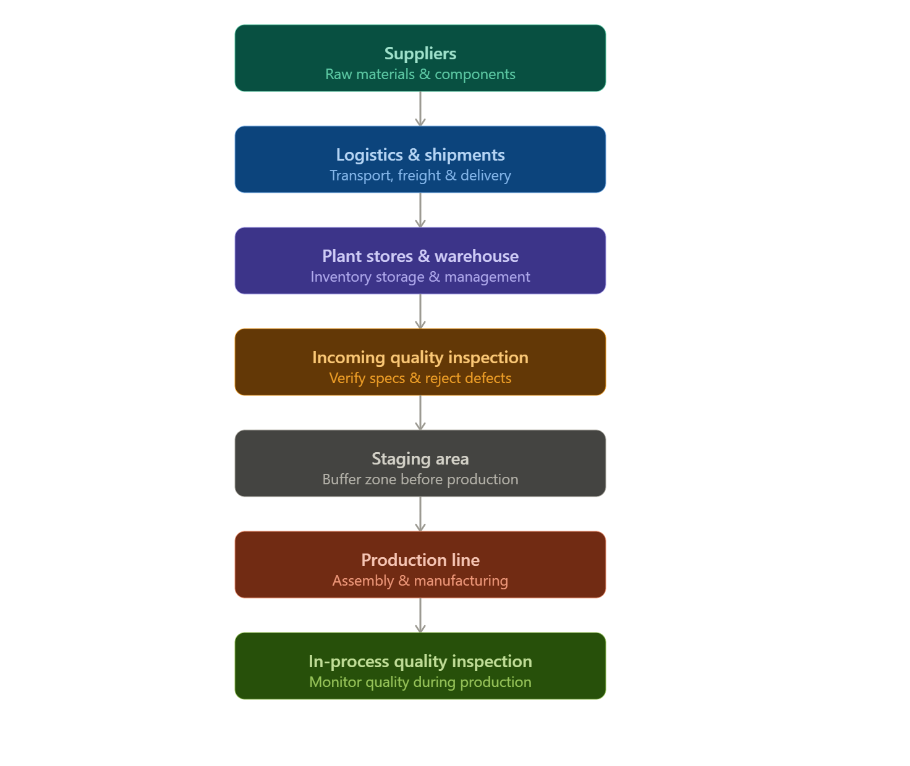

| Source | Examples of attributes | Used for |
| --- | --- | --- |
| Supplier shipment & logistics | Supplier ID, PO number, dispatch / expected / actual delivery dates | Lead-time variability, SLA adherence |
| Plant stores & warehouse (WMS) | GRN, batch number, quantity received, bin location | Lot traceability, inventory integrity |
| Incoming quality inspection (IQC) | Inspection ID, accepted / rejected quantity, defect type and severity | Supplier quality scoring |
| Staging area (MES) | Batch number, production line, workstation, VIN | Links inspected lots to the shop floor |
| In-process quality assurance | Workstation, VIN, defect class, rework / scrap action | Reverse traceability to supplier batches |

**Data characteristics:** structured and transactional, time-variant, high-volume, and multidimensional.

**Challenges addressed by the ETL strategy:** missing batch numbers, mismatched supplier IDs, duplicate records, unclear data ownership, inconsistent defect terminology, and incompatible systems.

## Data Warehouse Design

A layered Enterprise Data Warehouse (EDW) architecture with seven layers:

1. Operational data sources
2. ETL layer
3. Staging area
4. EDW core
5. Analytical data marts
6. Metadata repository
7. BI & analytics presentation layer

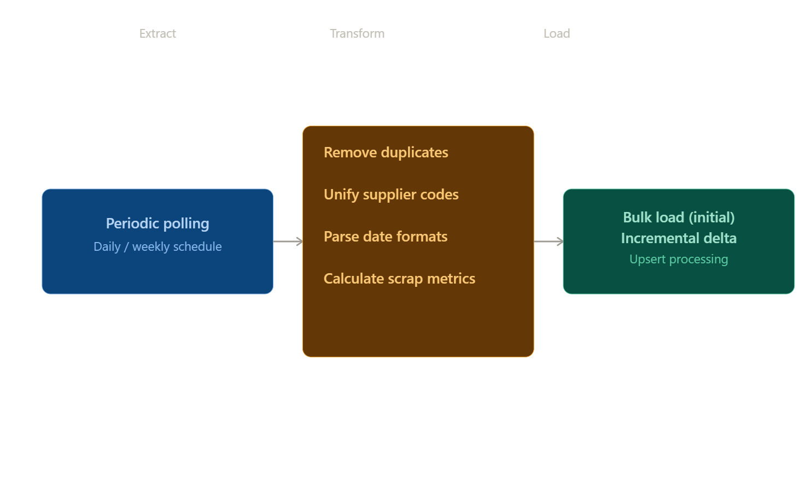

- **ETL:** scheduled batch / micro-batch extraction; deduplication, key harmonisation, date and defect-taxonomy standardisation; full load first, then incremental loads via Change Data Capture
- **Data marts (Kimball star schemas):** Supplier Performance, Incoming Quality, Production Quality
- **Metadata:** business, technical and operational metadata

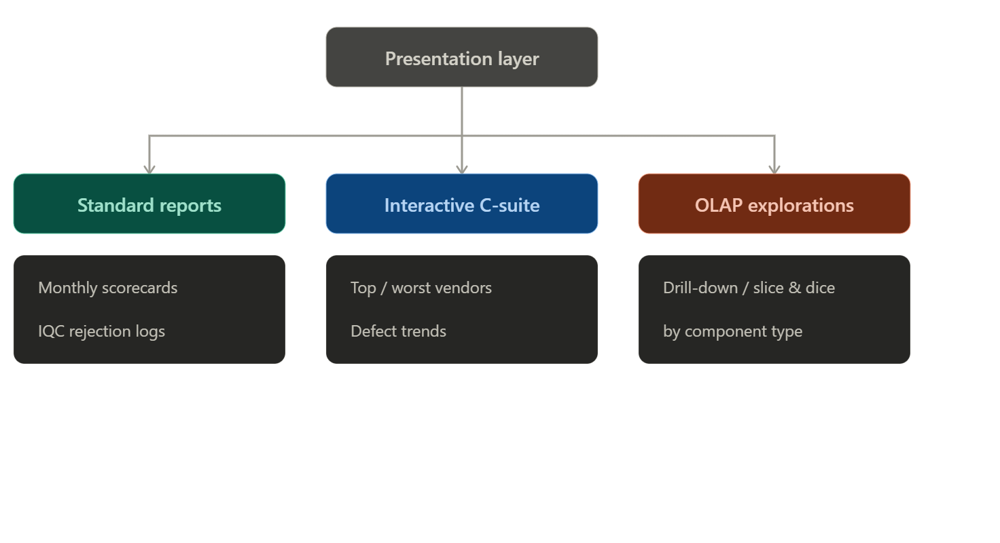

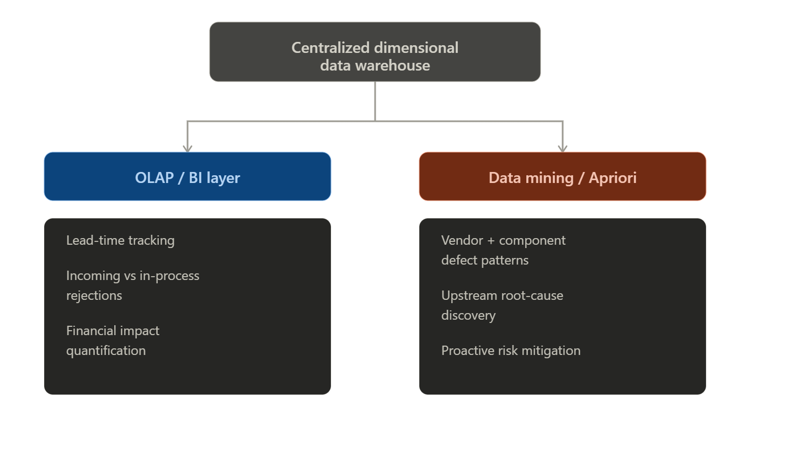

## Multidimensional Model (Galaxy Schema)

A **Galaxy (Fact Constellation) Schema** is used because the lifecycle has several business processes at different grains, which share conformed dimensions.

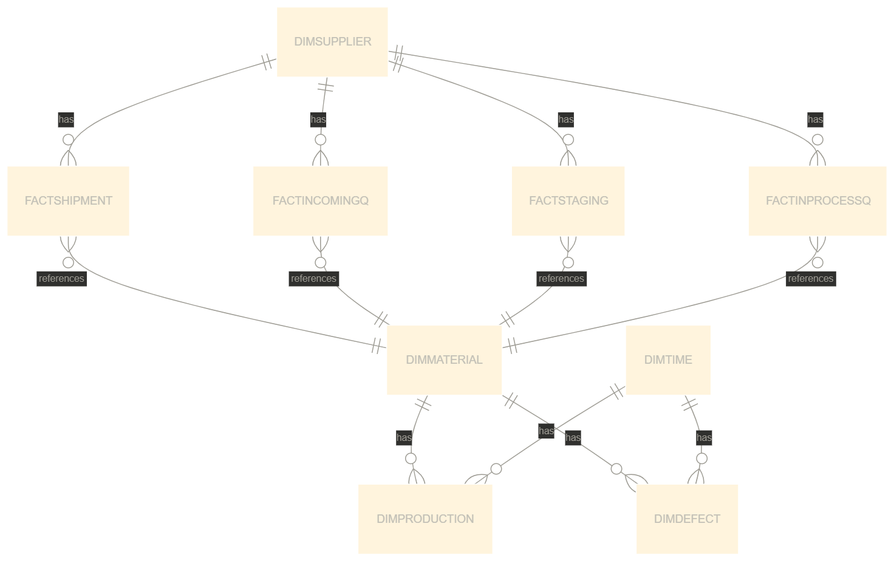

**Conformed dimensions:** `DimSupplier`, `DimMaterial`, `DimTime`, `DimDefect`, `DimProduction`

| Fact table | Grain | Key measures |
| --- | --- | --- |
| `FactShipment` | One line item per vendor shipment | QuantityShipped, DeliveryLeadTime, DeliveryDelayDays |
| `FactIncomingQuality` | One material batch per IQC inspection | QuantityInspected / Accepted / Rejected, RejectionRate |
| `FactStaging` | One batch moved to a line buffer | QuantityStaged, StagingDuration |
| `FactInProcessQuality` | One defect event during assembly | DefectCount, ReworkCount, ReworkCost |

The model supports questions such as which vendor-material pairs have the highest rejection rates, and which components pass incoming inspection but fail on the assembly line.

## Data Preparation

| Step | What is done |
| --- | --- |
| Cleaning | Deduplication on business keys, ISO date standardisation, supplier name mapping, business-rule validation (e.g. accepted + rejected = inspected) |
| Missing values | Drop rows missing key identifiers; impute with mode or carrier average lead time; use neutral placeholders such as "Unknown Supplier" |
| Outliers | IQR method (Q1 − 1.5×IQR, Q3 + 1.5×IQR) plus cross-department verification |
| Transformation | Aggregation, attribute generalisation and **discretisation** (e.g. rejection rate to Low / Medium / High risk) |
| Normalisation | Min-max and z-score (for exploration and charting) |
| Feature selection | Supplier, logistics, material, inspection and shop-floor attributes |
| Dimensionality reduction | Drop system metadata; consolidate defects into Electrical / Mechanical / Cosmetic |

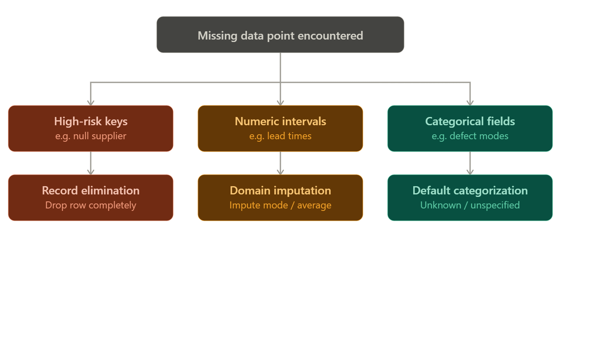

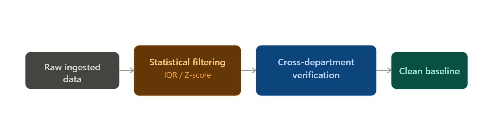

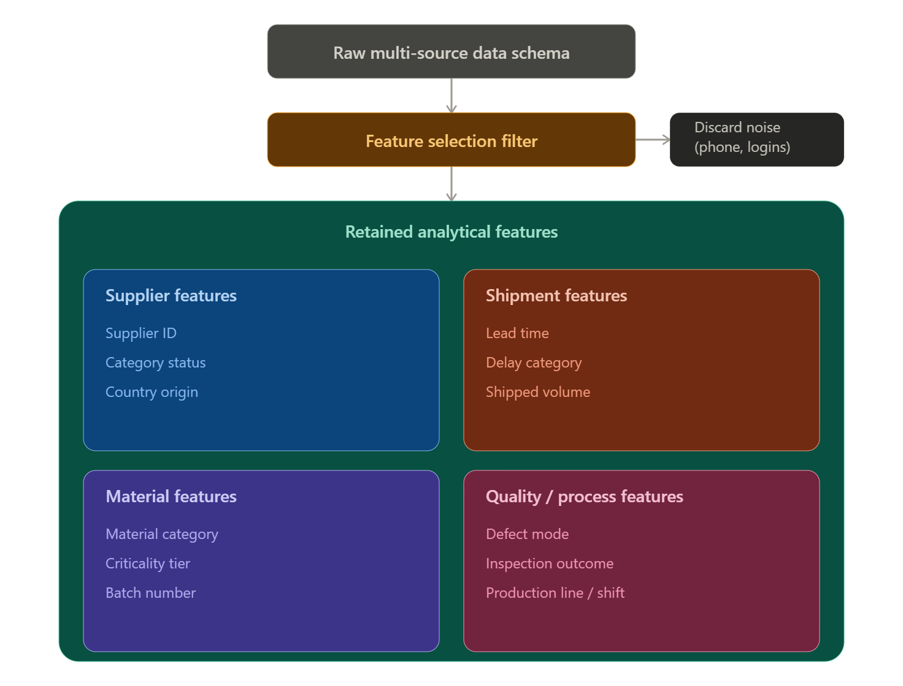

The final dataset is a **market-basket transaction table**, where each row is a set of operational states, for example `Supplier_A, Battery_Module, Severe_Logistics_Delay, Incoming_Rejection, Electrical_Defect`.

## Data Mining with Apriori

The **Apriori association rule algorithm** turns transaction data into IF-THEN rules (X ⟹ Y), using three metrics:

| Metric | Meaning |
| --- | --- |
| Support | How often the itemset appears across all transactions |
| Confidence | How often Y occurs when X occurs |
| Lift | How much more often X and Y occur together than if independent (> 1 means a positive association) |

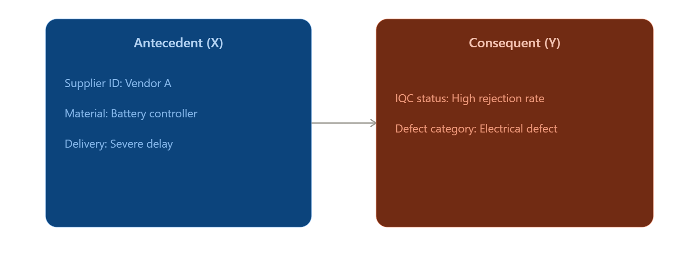

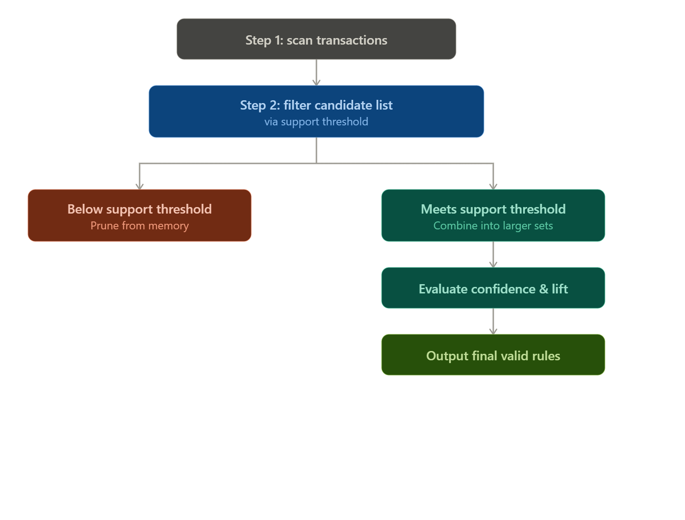

**Why Apriori?** It fits exploratory pattern discovery, works on multi-attribute transactional data, and produces rules that procurement managers can read. It was compared with decision trees (need a fixed target label) and K-Means (cannot produce actionable rules).

## Evaluation and Validation

Because confidential company data was not available, a **publicly available supply chain dataset** (about 3,089 supplier-related transactions) was adapted to simulate Spiro Uganda's context.

**Workflow**
1. Convert continuous variables (quality score, defect rate, reliability, delivery time) into categories
2. One-hot encode transactions with `TransactionEncoder` from **Mlxtend**
3. Run Apriori with **minimum support = 5%**
4. Generate rules with **minimum confidence = 70%**
5. Rank by lift and keep **strong rules** (confidence ≥ 80% and lift > 1)

### Encoded transactions
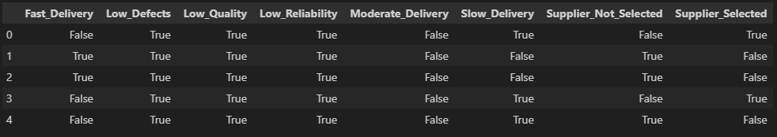

### Frequent itemsets
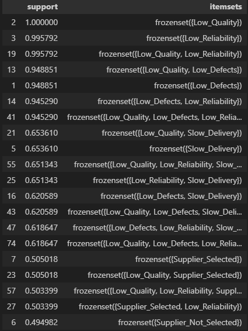

### Association rules generated (221 rules)
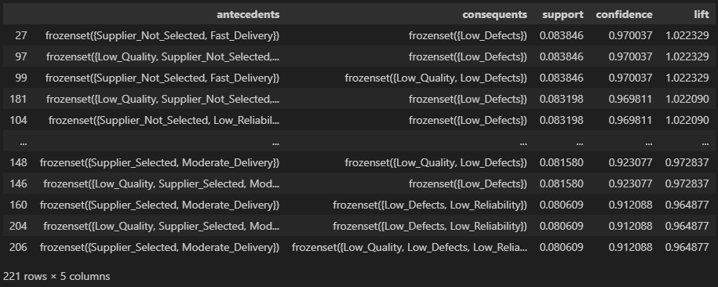

### Top rules by lift
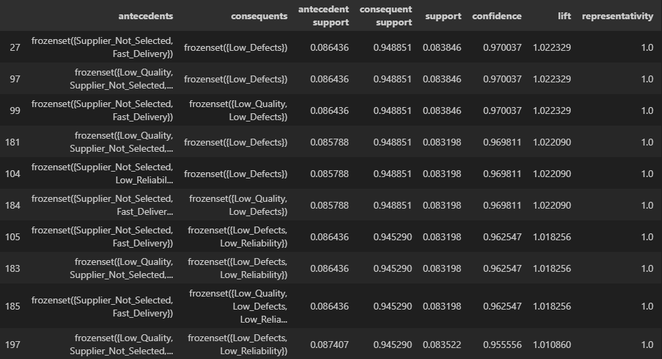

### Strong rules
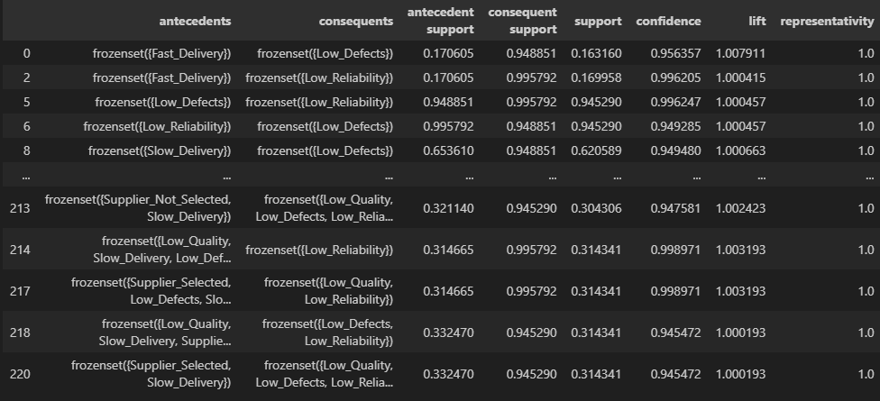

### Rankings and summary
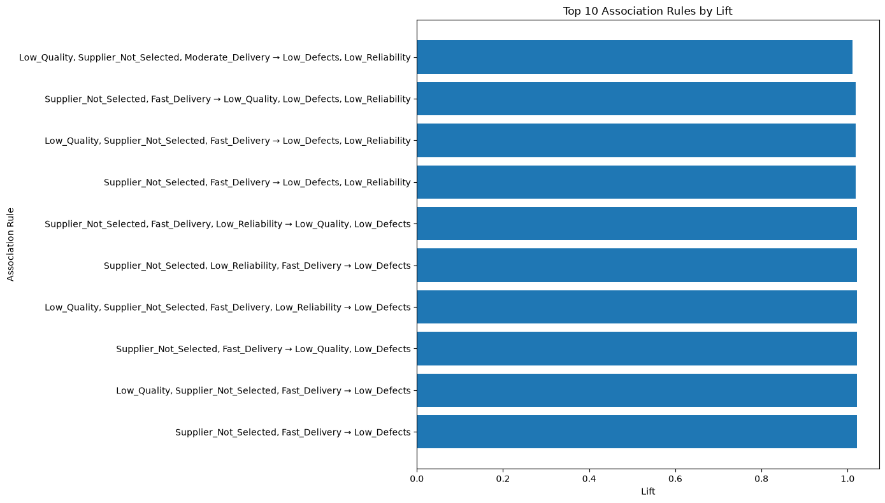

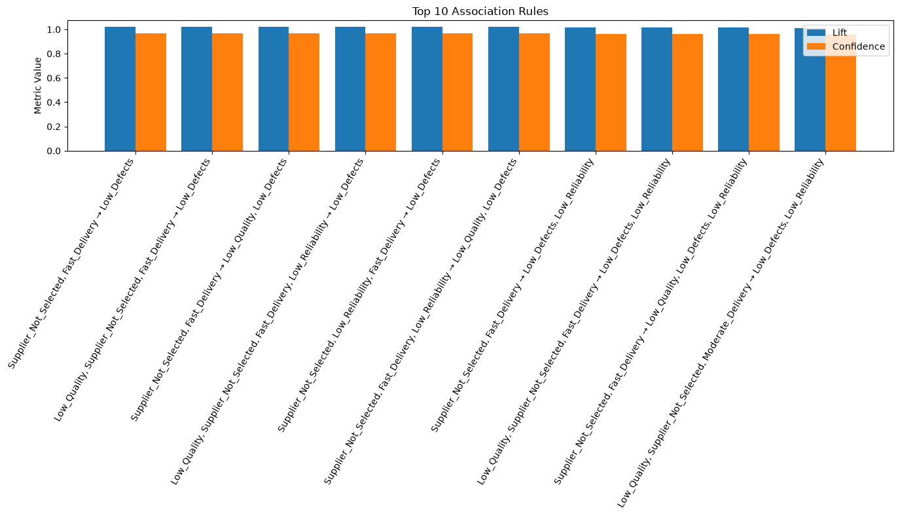

**Takeaways:** the rules show consistent links between supplier reliability, delivery performance, quality outcomes and supplier selection. Confidence is high, but **lift values are close to 1**, so the associations are relatively weak and should be read as supporting evidence rather than proof.

## Business Intelligence Dashboards

Four **Power BI** dashboards present the results.

### Executive Supplier Performance
Average quality score, defect rate, reliability score, delivery time and supplier selection statistics.

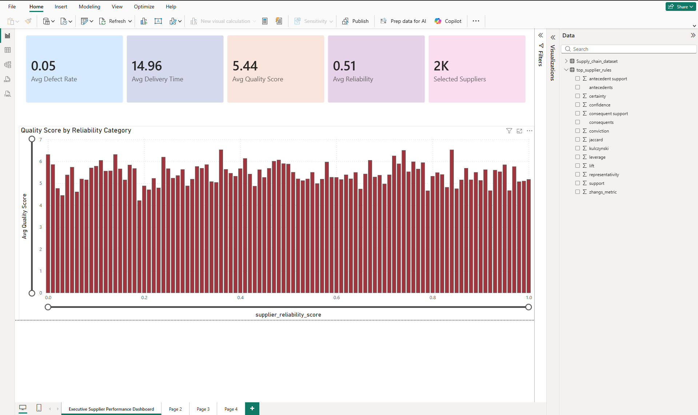

### Supplier Quality and Defect Analysis
Quality scores by reliability category and the link between reliability and defect rates.

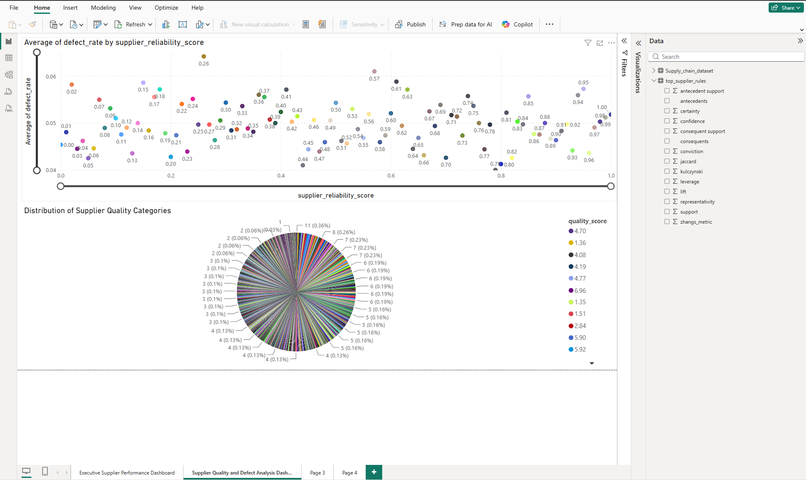

### Supplier Risk Management
Suppliers grouped into risk levels to prioritise monitoring and mitigation.

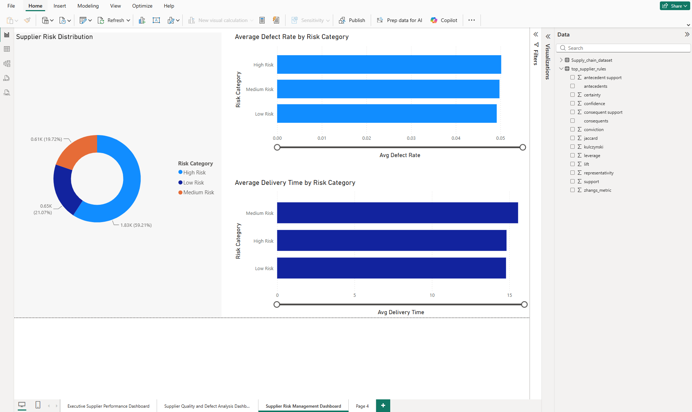

### Association Rule Mining
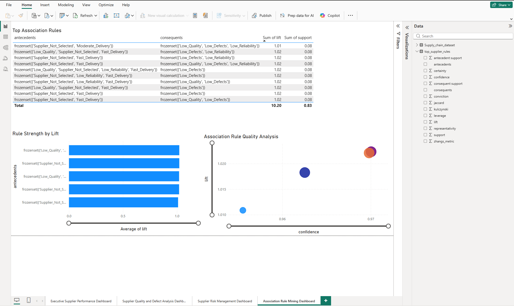

**Decision-support areas:** strategic supplier selection, operational efficiency, risk management, customer satisfaction (through product quality) and overall organisational performance.

## Future-State Architecture

A proposed cloud-based roadmap as data volumes grow:

- Data ingestion layer and **Data Lakehouse** (structured, semi-structured and unstructured data)
- **Cloud data warehouse** (Redshift, BigQuery, Snowflake or Azure Synapse)
- **Big data tools** (Apache Spark, Kafka)
- **AI / ML platform:** supplier risk prediction, defect prediction, demand forecasting, predictive maintenance, battery health analytics
- **Real-time analytics** (Kafka, Event Hubs, Kinesis)
- **Governance and security:** data quality, role-based access, metadata and lineage, compliance

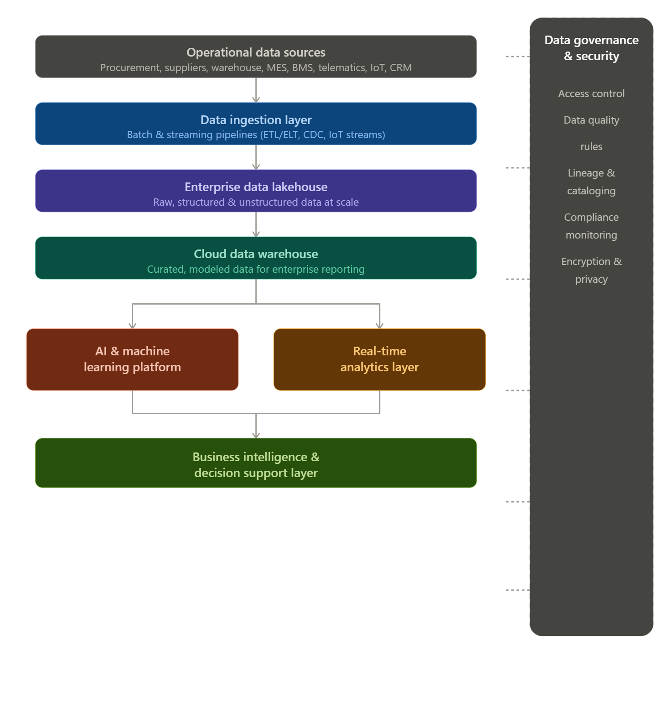

## Tech Stack

| Area | Tools |
| --- | --- |
| Language | Python |
| Data processing | Pandas, NumPy |
| Association mining | Mlxtend (`TransactionEncoder`, `apriori`, `association_rules`) |
| BI / dashboards | Power BI |
| Modelling | Kimball dimensional modelling (Galaxy schema) |

## Getting Started

```bash
# 1. Clone the repository
git clone https://github.com/YOUR-USERNAME/YOUR-REPO.git
cd YOUR-REPO

# 2. Install dependencies
pip install pandas numpy mlxtend matplotlib jupyter

# 3. Add the dataset (see data/ or the source link)

# 4. Open the notebook
jupyter notebook
```

Open the `.pbix` file in Power BI Desktop to explore the dashboards.

## Limitations

- **Public dataset:** results are representative of the approach, not exact reflections of Spiro Uganda's proprietary data
- **Correlation, not causation:** a high-lift rule does not prove a supplier caused a defect
- **Weak lift:** associations are modest (lift close to 1)
- **Scalability:** Apriori rescans the data repeatedly; **FP-Growth** is suggested for larger datasets
- **Possible biases:** supplier representation, historical data, data quality
- **Threshold sensitivity:** high minimum support can hide rare but critical failures

## References

- Han, J., Kamber, M., & Pei, J. (2022). *Data mining: Concepts and techniques* (4th ed.). Morgan Kaufmann.
- Kimball, R., & Ross, M. (2013). *The data warehouse toolkit* (3rd ed.). Wiley.
- Inmon, W. H. (2005). *Building the data warehouse* (4th ed.). Wiley.
- DAMA International. (2017). *The DAMA guide to the data management body of knowledge* (2nd ed.). Technics Publications.
- Turban, E., Sharda, R., Delen, D., & King, D. (2021). *Business intelligence, analytics, and data science* (5th ed.). Pearson.
- Opira, J. (2019). *Supplier involvement and organizational performance of manufacturing companies.* Kampala International University.
- Spiro. (n.d.). *About Spiro.* https://www.spironet.com/

## Author

**Registration No:** VU-MBD-2511-0359-WEE · Victoria University Kampala, Uganda
